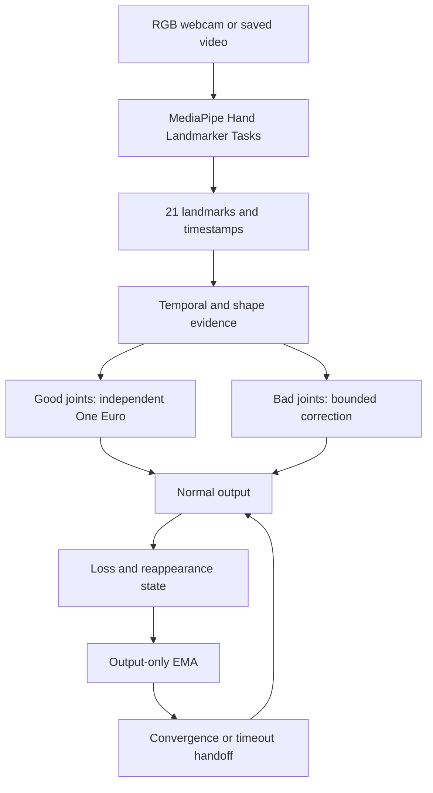

# HandLab 처리 구조

`tracker`는 관측 좌표를 생산하고 `anomaly`는 이전에 인정된 관측만 기준으로 손바닥·손목 이동, 속도·가속도, 공통 이동을 제외한 각 관절 잔차, 뼈 길이, 화면 경계와 handedness를 살핍니다. 단일 속도 초과는 오류 확정이 아닙니다. 손 전체 형태가 유지된 갑작스러운 이동은 의심 상태로 두고 3개 일관된 프레임이면 받아들입니다. 실제 순간적인 큰 이동도 잠시 멈춰 보일 수 있으며, 모델이 계속 같은 잘못된 위치를 내면 구분이 불가능합니다.

`correction`은 진짜 관측에서 얻은 마지막 속도로 최대 0.08초 예측하고 이동량을 손 크기의 0.35배로 제한합니다. 0.25초 뒤에는 예측 출력을 중단합니다. 나머지 정상 관절의 이동을 함께 이용해 잘못된 관절만 보정합니다. 가짜 값은 OEF와 정상 이력에 넣지 않습니다.

OEF는 관절 축별로 실제 `dt`를 사용합니다. 속도에 따른 차단 주파수는 `min_cutoff + beta × |speed|`이고 갱신 비율은 `alpha = 1/(1+1/(2π f dt))`입니다. 첫 관측과 1초 넘는 간격은 **새 실제 관측으로** 초기화합니다. EMA의 결과로 내부 상태를 강제 설정하지 않습니다.

재인식 EMA는 마지막으로 신뢰한 출력에서 시작하여 `alpha = 1-exp(-dt/tau)`로 독립 OEF 목표에 접근합니다. 같은 계수를 21개 관절 모두에 적용하면 공통 이동과 상대 자세가 함께 바뀝니다. 격차가 크면 `tau`를 최대 4배까지 줄여 뒤처짐을 제한합니다. EMA·OEF 사이 거리와 움직임 차이가 3개 프레임 연속 작으면 OEF로 전환합니다. 복구 타임아웃 시 0.15초 동안 출력 오프셋을 점진적으로 줄입니다. 긴 공백 또는 멀리 재등장한 손은 예전 위치에서 천천히 이동시키지 않고 재동기화합니다. 이 경우 출력 점프를 `resynced`로 기록합니다.

`Experiment`의 `raw`, `oef`, `corrected`, `full`, `custom`은 **같은 프레임 추론 결과를 별개의 파이프라인**에서 처리합니다. `raw`는 원본, `oef`는 OEF, `corrected`는 OEF·이상값 선택 보정, `full`은 EMA까지, `custom`은 GUI의 설정입니다. 측정 지표는 안정성 위주이며 실제 좌표 정답이 없는 영상에서는 자세 정확도 향상을 주장할 수 없습니다. 데이터 기록은 조절값이 바뀔 때 실험 `segment`를 구분합니다.
